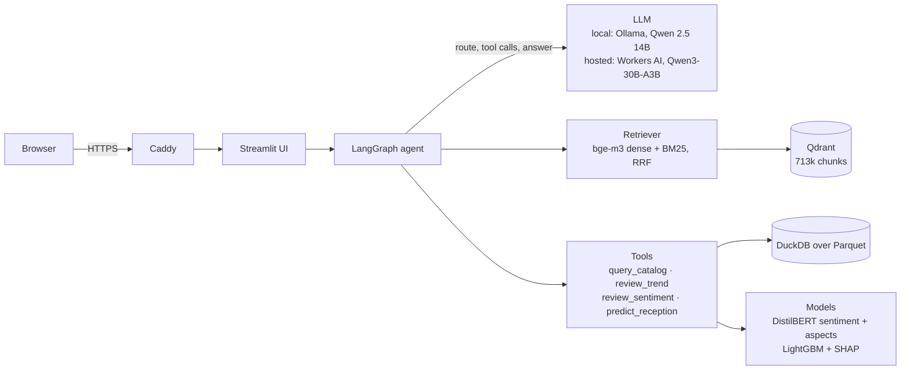
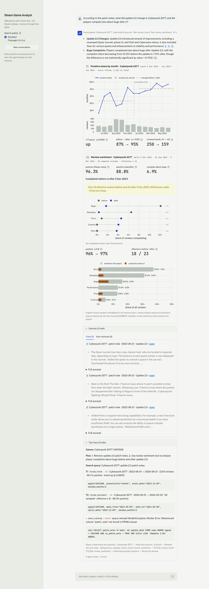
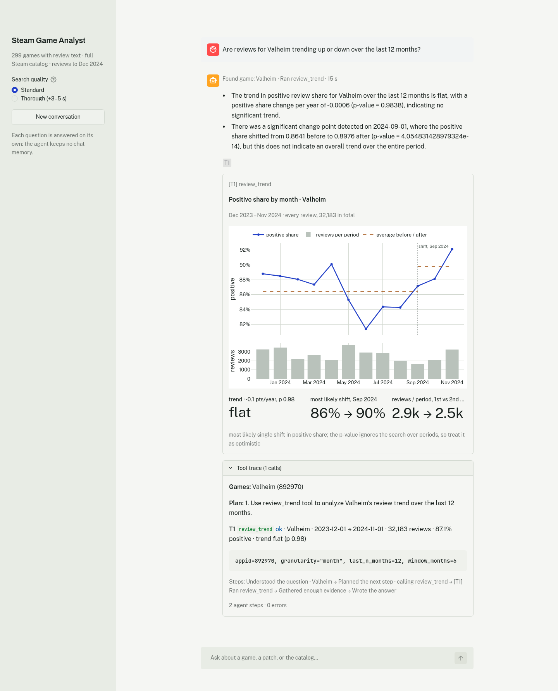
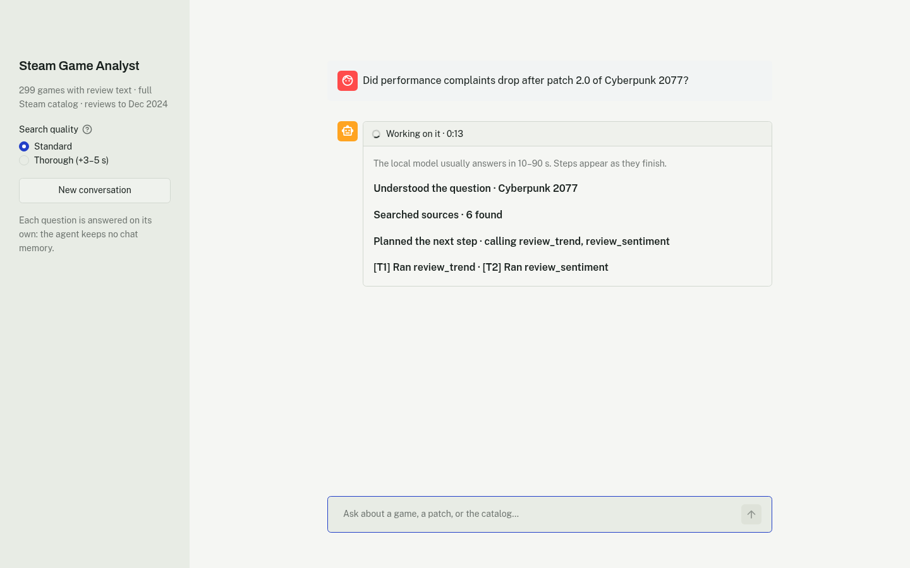
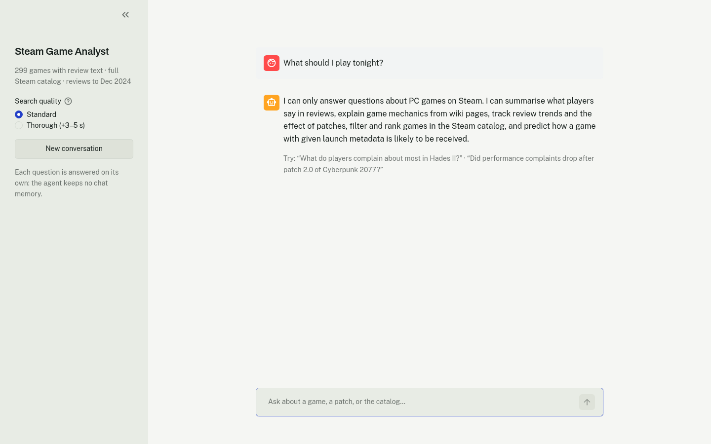

# Steam Game Analyst

An LLM agent that answers analytical questions about PC games by combining retrieval over
Steam reviews, patch notes and wiki pages with data-science tools (SQL over the catalog, a
review sentiment classifier, a reception predictor, trend tests). It runs two ways, both at
$0: fully local on one Linux box with an NVIDIA GPU (Qwen 2.5 14B via Ollama), or hosted on a
free Oracle Cloud ARM VM with a free hosted LLM (Qwen3-30B-A3B on Cloudflare Workers AI).

**Live demo: <https://92-5-85-76.sslip.io>.** The free LLM allowance is shared, so it takes
20 questions per visitor and 90 in total per day (reset at 00:00 UTC).

> Status: **W6 — deploy and write-up**. Data pipeline (W1), retrieval with cited answers
> (W2), the LangGraph agent with four data-science tools (W3), hybrid retrieval, DistilBERT
> and the gold sets (W4), a judged 60-question answer eval and the Streamlit UI (W5), and
> the hosted deploy (W6) work end to end. On the frozen test split 35–42% of answers are
> fully correct and grounded, with the local and the hosted model alike
> ([local](#end-to-end-evaluation-w5), [hosted](#hosted-deploy-w6)). See `docs/PRD.md` for
> the plan.

## Stack

| Layer | Choice |
| --- | --- |
| Storage | DuckDB over Parquet (`data/processed/`) |
| LLM | Qwen 2.5 14B / 7B Instruct via Ollama (local GPU); Qwen3-30B-A3B on Cloudflare Workers AI (hosted) |
| Embeddings / reranker | `BAAI/bge-m3`, `BAAI/bge-reranker-base` (sentence-transformers) |
| Vector store | Qdrant |
| Agent | LangGraph |
| ML | scikit-learn, LightGBM + SHAP, DistilBERT |
| UI | Streamlit |
| Hosting | Oracle Cloud Always Free A1 VM (arm64), Docker Compose, Caddy (HTTPS) |

## Architecture



A router call decides whether the question is in scope, which tools it needs and whether
quoted text is needed. Retrieval then fetches review, patch-note, news and wiki chunks; the
agent calls tools for up to 6 rounds; a final call writes the answer, citing documents as
`[n]` and tool results as `[Tn]`. Every number in an answer should come from a tool output
or a document. Locally Caddy is absent and Ollama serves the LLM on the GPU.

## Data sources (all free; join key `appid`)

| Source | Role | License |
| --- | --- | --- |
| [FronkonGames Steam Games Dataset](https://huggingface.co/datasets/FronkonGames/steam-games-dataset) | catalog, structured features | MIT |
| [Steam Games Metadata and Player Reviews 2020–2024 (Mendeley)](https://data.mendeley.com/datasets/jxy85cr3th/2) | 31M reviews | see dataset page |
| [Steam Web API — GetNewsForApp](https://steamcommunity.com/dev/apiterms) | patch notes / announcements | free key, attribution |
| [Fandom](https://www.fandom.com) wikis, via each wiki's MediaWiki API | wiki pages (largest 300 per game wiki) | CC BY-SA 3.0 |

Raw data is downloaded at build time and never committed. Author/Steam ids are dropped
during cleaning; only derived artefacts (aggregates, embeddings, models) are published.

Coverage, sampling choices, known gaps and privacy: [docs/DATA_CARD.md](docs/DATA_CARD.md).
Exploratory analysis: [notebooks/01_eda.ipynb](notebooks/01_eda.ipynb).

## Quick start: local (host with Docker + NVIDIA Container Toolkit)

```bash
cp .env.example .env            # add your STEAM_API_KEY
make build                      # build the app/pipeline image
make up                         # ollama + qdrant + app (http://localhost:8501)
make pull-models                # pull the LLMs into the ollama volume
make data                       # download sources, select the subset, build Parquet + DuckDB
docker compose run --rm pipeline data stats
make index                      # chunk + embed (bge-m3, GPU) into Qdrant
docker compose run --rm pipeline ask "How does the crafting system work in Valheim?"
```

GPUs are requested through CDI (`nvidia.com/gpu=all`), so after installing the NVIDIA
Container Toolkit generate the spec once (`sudo nvidia-ctk cdi generate --output=/etc/cdi/nvidia.yaml`);
no Docker restart is needed.

`make data` downloads the catalog (~hundreds of MB) and the Mendeley review archive
(several GB), then builds:

```
data/processed/
  games_all.parquet      full catalog, canonical columns
  review_counts.parquet  appid -> number of reviews available
  games.parquet          the project subset (configs/pipeline.yaml: 300 games, 2020-2024, genre-balanced)
  reviews.parquet        cleaned + stratified sample (1,500/game, all languages tagged with
                         lingua, no author ids)
  news.parquet           patch notes / announcements for the subset
  wiki.parquet           Fandom wiki sections for the subset (configs/wikis.yaml fixes bad matches)
  review_volume.parquet  monthly review / positive counts over every cleaned review
                         (the population behind the stratified sample)
  sga.duckdb             views over the parquet files + review_monthly + game_summary
```

Tune the subset with `SGA_SUBSET_GAMES` / `SGA_REVIEWS_PER_GAME` in `.env` or edit
`configs/pipeline.yaml`, then `make subset`.

## Retrieval and answers (W2)

`sga index build` chunks reviews (one per review), patch notes/news (by paragraph) and wiki
pages (by section), embeds them with `bge-m3` and loads one Qdrant collection whose payload
carries the filterable fields (game, doc type, date, language, recommended, playtime).
Each chunk also gets a BM25 sparse vector, computed on the CPU (Qdrant supplies the IDF);
search fuses the dense and BM25 rankings with RRF, so exact names, version numbers and
jargon ("DLSS", "2.0") are found even when the embedding misses them. Collections built
before W4 lack these vectors: rebuild with `sga index build --recreate`.
`sga ask` matches game names in the question, parses simple filters ("50+ hours",
"mentioning X", "since 2023"; flags `--game`, `--doc-type`, `--min-hours`, `--language`
override), retrieves, and answers with Qwen 2.5 14B via Ollama with numbered citations.
`--no-llm` shows the retrieved sources only.

On a 10 GB card the 14B model (~9 GB) and bge-m3 do not fit together: indexing embeds on
the GPU (stop Ollama's models first), query-time embedding runs on the CPU.

`sga eval synth` starts the retrieval gold set: one LLM-written question per sampled chunk,
each assigned a frozen `dev`/`test` split from a hash of its id. Tune only on `dev`; report
`test` once. `sga eval retrieval --mode hybrid|dense|bm25` compares the
retrieval legs on the same questions.

## ML tools and agent (W3)

```bash
uv run sga train sentiment      # or run notebooks/02_sentiment.ipynb  -> models/
uv run sga train reception      # or run notebooks/03_reception.ipynb  -> models/
uv run sga agent "Did performance complaints drop after patch 2.0 of Cyberpunk 2077?"
uv run sga agent --no-retrieval "Which roguelikes released in 2024 have the best review ratio among games under €20?"
```

`sga agent` runs a LangGraph state graph: **router** (JSON plan, scope check, refusal path)
→ **retrieve** (the W2 retriever, filtered to the games named in the question) → **agent**
(Qwen 2.5 via `ChatOllama` with the four tools bound) ⇄ **tools** (pydantic-validated calls;
invalid arguments, refused SQL and unseen appids go back to the model on the retry edge;
at most 6 rounds and 5 calls per round) → **answer** (cites tool results `[T1]` and documents
`[1]`; uncited answers are rewritten once). Every run is appended to `data/traces/agent.jsonl`.

| Tool | What it does |
| --- | --- |
| `query_catalog(sql)` | one read-only SELECT over allow-listed views (`n_votes` and a Wilson lower bound `positive_ratio_lower95` added for ranking); parser check (no table functions, no qualified names) plus a sandboxed DuckDB connection (files outside `data/processed/` blocked, config locked, 1 GB memory), 200-row and 500-char cell caps, 20 s timeout, "did you mean" tag names on empty results |
| `review_sentiment(appid, from, to, split_date?)` | weighted positive share and aspect mentions / complaints (performance, bugs, gameplay, story, price, controls) on the English sample, reweighted to the population; before/after test per aspect |
| `predict_reception(features)` | bucket probabilities + TreeSHAP top features for a hypothetical launch |
| `review_trend(appid, granularity, event_date?)` | monthly / quarterly volume and positive share from population counts, WLS trend, change point or before/after test |

Held-out results (`models/*.metrics.json`):

| Model | Split | Metric | Model | Majority baseline |
| --- | --- | --- | --- | --- |
| Sentiment, TF-IDF + LR | 55 unseen games, 38.4k English reviews | F1 (positive) / macro-F1 / ROC-AUC | 0.884 / 0.872 / 0.944 | 0.700 / 0.350 / 0.5 |
| Sentiment, DistilBERT (fine-tuned, 2 epochs) | same 55 games, same reviews | F1 (positive) / macro-F1 / ROC-AUC | 0.913 [0.904, 0.923] / 0.905 / 0.968 | 0.700 / 0.350 / 0.5 |
| Aspects, keyword lexicon | 300 reviews of held-out games, gold labels | macro-F1 | 0.730 [0.667, 0.781] | — |
| Aspects, DistilBERT (qwen2.5 14B silver labels, 12k reviews) | same 300 reviews | macro-F1 | 0.736 [0.681, 0.780] | — |
| Aspects, DistilBERT (Claude labels, 3k reviews, 10 epochs) | same 300 reviews | macro-F1 | 0.707 [0.652, 0.751] | — |
| Reception, LightGBM | released 2023-01 to 2024-05, ≥ 12 months of reviews (3,951 games, ≥ 50 votes) | accuracy [95% CI] / macro-F1 / log loss / ECE | 0.661 [0.647, 0.674] / 0.428 / 0.791 / 0.007 | 0.645 / 0.261 / 0.950 / 0.145 |

The aspect model ties the lexicon (+0.006 macro-F1, 95% CI [−0.057, +0.068]): it finds far more
gameplay talk (F1 0.82 vs 0.57) but is worse on performance and story. Its teacher caps it: the
qwen2.5 14B silver labels themselves score 0.743 against the gold set, over-tagging controls,
story and performance. A blind human check of 35 gold reviews agreed with the gold labels at
macro-F1 0.79, which is about as close as two careful readers get.
Retraining on 3,000 Claude-labelled reviews (cleaner: qwen's controls and performance tags
agree with Claude's only 45-48% of the time) scored lower, 0.707: a quarter of the data left
about 150 examples each for performance and controls. Three configurations have now been
scored on the gold set, so no more are tried against it; the review_sentiment tool keeps the
lexicon.

DistilBERT beats TF-IDF + LR by +0.029 F1 (95% CI [+0.026, +0.033], resampling held-out
games) and scores higher on 53 of the 55 test games; its hyperparameters were fixed in
advance and only the epoch was picked on validation games.
`review_sentiment` uses it (`SGA_SENTIMENT_MODEL=tfidf` switches back). Live on the CPU it
takes 15-20 s per call, so `sga train sentiment-scores` scores every review and aspect sentence
once on the GPU (342k texts, a few minutes) and the tool looks them up (0.1 s); text missing
from the table is scored live.

The reception model beats always predicting "very positive" by **+1.6 points** of bucket
accuracy (95% CI [+0.6, +2.8]) on games released from January 2023 to May 2024, and gives much
better probabilities (log loss 0.79 vs 0.95, calibration error 0.007 vs 0.145). The test is
limited to games with at least a year of reviews before the catalog snapshot (about June 2025:
vote counts collapse for later releases), because early ratings run high: very positive games
are 67% of all 2023+ games but 64.5% of the mature ones. On the previous definition (every
2023+ game) the gain was +0.7 [−0.1, +1.4]. The maturity rule was adopted after that result,
so this test number is not fully blind. Before it, five variants were compared on the 2022
validation year only (recency weighting, rescaling to the latest year's class mix, dropping
release-date features, developer/publisher track-record shape); none beat the existing model
(+3.7 points there), so the model itself is unchanged. Its strongest features are the
developer's and publisher's earlier ratings, release year and price. Catalog fields are
snapshot values, not the exact launch state, so scores may be slightly optimistic (see
`caveats` in the metrics file).

Known limits: the review corpus runs through November 2024 (the last full month) and has no
Starfield or RDR2 reviews, so U7 gets an honest "no data" answer; aspects come from a keyword
lexicon (a DistilBERT aspect model tied it, see above); aspect tests are underpowered in short
windows (~1,500 sampled reviews per game across all years); the agent sometimes searches the
300-game subset where the full catalog was meant; answers take 20 s at the median and 37 s at
p95 on the test set. The W5 evaluation below measures where answers go wrong.

## Retrieval evaluation (W4)

**Gold set:** 195 questions, one written by the local LLM from each sampled chunk (reviews,
patch notes, news and wiki sections), split 107 dev / 88 test by a hash of the question id.
The plan asked for half of them to be checked by hand and for hand-written questions against
U1–U8; neither was done, so the set leans towards questions one chunk answers, and a badly
written question counts against every mode alike. **Judging is pooled:** the
top 10 chunks of every mode, plus the source chunk, are graded blind by a Claude judge (0 =
does not help, 1 = relevant evidence, 2 = answers it), and every mode is scored against all
chunks graded relevant (2,672 grades on dev). `make eval` reproduces the table from the
grades.

| Dev (106 questions, top 10) | hit@5 | hit@10 | MRR@10 | nDCG@10 |
| --- | --- | --- | --- | --- |
| BM25 | 0.764 | 0.830 | 0.662 | 0.457 |
| Dense (bge-m3) | 0.821 | 0.830 | 0.728 | 0.545 |
| **Hybrid (RRF), default** | 0.858 [0.792, 0.925] | 0.887 [0.821, 0.943] | 0.744 [0.674, 0.816] | 0.554 [0.495, 0.618] |
| Hybrid + rerank | 0.887 [0.821, 0.943] | 0.906 [0.849, 0.962] | 0.809 [0.740, 0.876] | 0.669 [0.605, 0.730] |

Paired against hybrid, the reranker improves nDCG@10 by +0.115 [+0.074, +0.159] (64
questions better, 19 worse) and MRR@10 by +0.065 [+0.003, +0.126]; BM25 alone is worse
(nDCG −0.097 [−0.134, −0.060]); dense alone ties hybrid. Hybrid stays the default anyway
because reranking did not improve the answers (see [Decisions made on dev](#decisions-made-on-dev)).
The test split has not been scored yet: its 2,066 pooled chunks still need grading.

## Streamlit UI (W5)

`make up` serves the app on http://localhost:8501. Each answer shows its citations as chips:
`[T1]` points at a tool card, `[1]` at a source. Tool cards draw the review trend
(monthly positive share with the change point or event date marked) and before/after
complaint shares per aspect. The card header shows the event or split date the agent chose,
so a wrong patch date is visible. A small-sample warning appears when either side of a
before/after split has fewer than 30 effective reviews. Sources are split into "Cited" and
"Also retrieved", and the tool trace lists the router's plan and every call. The
screenshots below come from live runs of the 14B model on questions outside the eval set.

| Answer with citations and cards | Trend |
| --- | --- |
|  |  |
| **Waiting, with live steps** | **Out of scope** |
|  |  |

When Ollama or Qdrant is down the app says which one and offers a sources-only search
([screenshot](docs/img/ui-services-down.png)). The agent keeps no chat memory: each
question is answered on its own.

## End-to-end evaluation (W5)

```bash
uv run sga eval answers --split dev --label hybrid-14b             # run the agent, score routing + latency
uv run sga eval judge-batch data/eval/results/answers_dev_*.jsonl --name my-batch
uv run sga eval judge-score --name my-batch --judge claude --second second
```

**Question set** (`data/eval/answer_questions.jsonl`): 60 questions, 20 dev and 40 test,
across catalog, trend, sentiment, patch impact, reception, wiki and patch-note lookup,
multi-tool, out-of-scope and no-data questions. Each lists the tools it must call, the
tools it may call, and 1–3 key points. The key points were computed from the data with the
ideal tool calls, not from the agent's answers. Every number in them was checked against its
evidence, and each question was reviewed by hand before any run. The 5 questions used to
tune the agent in W3 are left out. Some questions test refusals: a false premise, too few
English reviews, a game without reviews, and a game not in the catalog.

**Routing and latency** come from the run itself. Routing is exact when the scope call is
right, every required tool was called, no tool outside the allowed set was called, and
retrieval ran when the question needs quoted text.

**Answer quality** is graded by an LLM judge (Claude) on a fixed rubric: **correct** 0–2
against the key points, **grounded** 0–2 against the agent's own tool outputs and documents
(invented numbers or significance claims count against it), and **cites** 0–1. **Pass** =
correct 2 and grounded 2. Batches are blind: the judge doesn't know which configuration
wrote an answer. A second judge (another Claude model) grades every answer independently.

### Test results (frozen split, run once)

40 questions, hybrid retrieval, Qwen 2.5 14B q4 on an RTX 3080, commit `cf175e3`.

| Routing exact | Required-tool recall | Unexpected tool | Scope correct | Latency p50 / p95 |
| --- | --- | --- | --- | --- |
| 82% | 95% | 8% | 98% | 20.1 s / 36.8 s |

| Judge | Correct (0–1) | Grounded (0–1) | Pass [95% CI] |
| --- | --- | --- | --- |
| Claude (primary) | 0.66 | 0.80 | **0.40** [0.25, 0.55] |
| Claude (second judge) | 0.66 | 0.81 | 0.35 [0.20, 0.50] |

| Category (primary judge) | n | Correct | Grounded | Pass |
| --- | --- | --- | --- | --- |
| Wiki and patch-note lookup | 7 | 0.86 | 0.93 | 0.57 |
| Trend | 5 | 0.90 | 0.70 | 0.60 |
| Sentiment | 5 | 0.80 | 0.80 | 0.40 |
| Reception | 4 | 0.75 | 0.62 | 0.25 |
| Patch impact | 5 | 0.40 | 0.60 | 0.20 |
| Multi-tool | 3 | 0.33 | 0.67 | 0.00 |
| Catalog | 7 | 0.29 | 0.93 | 0.14 |
| Out of scope and no data | 4 | 1.00 | 1.00 | 1.00 |

Correct and grounded are mean grades on a 0–1 scale; CIs bootstrap over questions.

Where it fails:

- **Catalog questions** report their query output faithfully but run the wrong query: the
  Building tag instead of City Builder, an extra filter, or the 300-game subset instead of
  the full catalog.
- **Patch impact** depends on finding the right event date. Darktide's Patch #17 was tested
  at October 2023 instead of February 2024, which reversed the conclusion.
- **Reception answers** sometimes invert SHAP directions.
- **Significance** is claimed for comparisons no tool tested.
- **Two wrong refusals:** the peak-players question, and Baldur's Gate 3 vs ELDEN RING
  playtime ("data missing").

Refusals and no-data questions all pass. The dev pass rates (0.35–0.50) predicted the test
result.

### Can the judge be trusted?

| Comparison | Correct (weighted κ) | Grounded |
| --- | --- | --- |
| Judge vs second judge, 80 dev answers | 0.97 | κ 0.81 |
| Judge vs second judge, 40 test answers | 0.88 | κ 0.84 |
| Human (blind, 20 dev answers) vs judge | 0.58 (second judge 0.61) | 45% exact agreement |

The two judges agree closely. The human grades, made blind before seeing any judge grade,
agree moderately on correctness. Every disagreement went the same way: the judges graded
lower, never higher.

On grounding the human gave the top grade to 18 of 20 answers, so κ is not meaningful
there. Checking the disagreements against the evidence supported the judges. One answer read
well but claimed there were no English reviews for Tale of Immortal, while its own documents
included three. A reader who doesn't open the evidence misses that kind of error, which is
why grounding is graded by the judge.

### Decisions made on dev

| Dev run (20 questions) | Correct | Grounded | Pass [95% CI] | Routing exact | p95 |
| --- | --- | --- | --- | --- | --- |
| hybrid, W4 prompts | 0.68 | 0.93 | 0.50 [0.30, 0.75] | 95% | 31 s |
| rerank, W4 prompts | 0.72 | 0.78 | 0.35 [0.15, 0.55] | 95% | 44 s |
| hybrid, + router line + formatting rules | 0.72 | 0.68 | 0.40 [0.20, 0.60] | 95% | 41 s |
| rerank, + router line + formatting rules | 0.68 | 0.62 | 0.40 [0.20, 0.60] | 90% | 42 s |
| hybrid, formatting rules reworded | 0.72 | 0.75 | 0.45 | 95% | 43 s |

- **Hybrid stays the default retrieval mode.** Rerank ranked chunks better in W4 (nDCG
  +0.115), but its answers were no better, and with the W4 prompts its p95 was 12.5 s
  slower (with the other prompts it was within a second of hybrid).
- **A router line puts in-game content in scope** (mechanics, characters, story, items). The
  W4 router refused "Who runs Bancho Sushi in Dave the Diver?".
- **Answer-formatting rules were tried and dropped.** The rules asked for percentages and
  tidy p-values. Paired against the W4 prompt, grounding fell by 0.17 [−0.30, −0.05], with 0
  questions better and 6 worse, and correctness didn't improve. The model began adding
  untested significance claims. Rewording the rule didn't recover it, so the test run uses
  the W4 answer prompt with only the router line added. That exact combination was not run
  on dev before the test; the test run measures it.
- **The game finder now matches a main title before a colon** ("New World" → New World:
  Aeternum), after a dev answer analysed the wrong game.

### Would a bigger local model help?

Qwen 2.5 32B q4 (~20 GB) does not fit in the 3080's 10 GB, so Ollama runs about half of it
on the CPU. Both models answered the 20 dev questions on the same commit (`cf175e3`), and
the answers were judged in one blind batch:

| Dev, same commit | 14B | 32B |
| --- | --- | --- |
| Correct / grounded (0–1) | 0.82 / 0.93 | 0.72 / 0.82 |
| Pass [95% CI] (second judge) | 0.65 [0.45, 0.85] (0.75) | 0.50 [0.30, 0.70] (0.45) |
| Routing exact | 95% | 85% |
| Latency p50 / p95 | 20 s / 30 s | 100 s / 151 s |
| GPU utilization (mean) / RAM (max) | 42% / 14.3 GB | 13% / 14.6 GB |

The 32B is not better: 32B − 14B on correct is −0.10 [−0.30, +0.10] (2 questions better, 5
worse; second judge −0.15 [−0.30, 0.00]). It is also 5× slower, because the GPU waits on the
CPU layers. Its errors are the same kind as the 14B's: windows that flip a conclusion, an
invented update date, skipped sentiment calls on patch questions, and untested significance
claims. They come from the agent's tool-use choices rather than model size, so the 14B
stays. The 14B's 0.65 here is above its test result (0.40), because these 20 questions
informed W5's decisions; the test number is the one to quote.

## Hosted deploy (W6)

No free machine runs the whole stack with a 14B-class model, so the hosted version keeps
everything except the LLM on a free VM and moves the LLM to a free hosted endpoint.

| Piece | Where | Notes |
| --- | --- | --- |
| Streamlit app, agent, tools, bge-m3 query embeddings | Oracle A1 VM, 2 OCPU / 12 GB, arm64 | CPU-only image (`docker/app.cloud.Dockerfile`) |
| Qdrant (713,080 chunks) | same VM, not published | restored from a snapshot of the dev box's collection |
| LLM | Cloudflare Workers AI, `@cf/qwen/qwen3-30b-a3b-fp8` | OpenAI-compatible API, reasoning on |
| HTTPS | Caddy, Let's Encrypt certificate for `<ip>.sslip.io` | no domain needed |

The VM uses 3.7 of 12 GB RAM (Qdrant 2.2 GB, the app 1 GB) and 22 GB of disk.

```bash
# from the dev box, which holds the data and the Qdrant collection
export SGA_DEPLOY_HOST=ubuntu@<vm ip> SGA_DEPLOY_KEY=~/.ssh/<key>
scripts/deploy.sh all        # bootstrap Docker + firewall, env, sync, index, up
scripts/deploy.sh sync && scripts/deploy.sh up    # later: redeploy code
```

`.env` on the dev box needs `SGA_LLM_BASE_URL` (`https://api.cloudflare.com/client/v4/accounts/<account id>/ai/v1`)
and `SGA_LLM_API_KEY` (an API token with Workers AI permission); `deploy.sh env` copies only
those two lines to the VM. The Oracle VCN security list must allow TCP 80 and 443. `sync`
copies the source, the Parquet tables and the trained models (~750 MB); `index` ships the
Qdrant collection as a 6.2 GB snapshot; `up` builds the image on the VM, rebuilds
`sga.duckdb` there (its views hold absolute paths) and loads bge-m3 once.

The same code runs locally against any OpenAI-compatible endpoint:
`SGA_LLM_PROVIDER=openai SGA_LLM_BASE_URL=... SGA_LLM_API_KEY=... SGA_LLM_MODEL=...`.

**Free allowance.** Workers AI gives 10,000 neurons a day, and the free plan fails requests
past that. With reasoning on, a question costs about 105 neurons (2,060 for the 20 dev
questions, 4,282 for the 40 test questions), so about 95 questions a day. The app therefore
caps questions at 20 per visitor and 90 in total per UTC day, and at 500 characters each.
A capped visitor can still search the sources without a written answer. The "Thorough"
(rerank) search is hidden here: the reranker is 2.2 GB and would score 50 passages per
question on 2 ARM cores.

### Choosing the hosted model

All three configurations answered the 20 dev questions and were judged in one blind batch:

| Dev (20 questions) | Local 14B | Qwen3-30B, reasoning off | Qwen3-30B, reasoning on |
| --- | --- | --- | --- |
| Correct / grounded (0–1) | 0.88 / 0.93 | 0.62 / 0.80 | 0.90 / 0.82 |
| Pass [95% CI] (second judge) | 0.75 [0.55, 0.90] (0.60) | 0.35 [0.15, 0.55] (0.35) | 0.65 [0.45, 0.85] (0.60) |
| Latency p50 / p95 | 20 s / 30 s | 4 s / 7 s | 17 s / 25 s |
| Neurons per question | — | ~47 (estimated) | 103 |

- **Reasoning stays on.** Without it Qwen3 misreads its own tool output: "no significant
  change" next to a significant increase, the story ranked below gameplay when its numbers
  said the opposite. Against the 14B it was worse on 8 questions and better on none
  (correct −0.25 [−0.40, −0.12]). With reasoning it matches the 14B (+0.03 [−0.05, +0.12]);
  without it, it also refused an in-game question the router should accept.
- **Gemini's free tier was tried and dropped.** Gemini 3.8 Flash works through the same
  client (its thought signatures are passed back with tool calls), but the free tier allows
  5 requests a minute per model, about one question a minute for all visitors.

### Test results (hosted, frozen split, run once)

40 questions, hybrid retrieval, Qwen3-30B-A3B with reasoning on Workers AI, commit `9217bbb`,
judged blind in one batch with the W5 14B test answers.

| Routing exact | Required-tool recall | Unexpected tool | Scope correct | Latency p50 / p95 |
| --- | --- | --- | --- | --- |
| 85% | 94% | 0% | 98% | 17.4 s / 28.1 s |

| Test (40 questions) | Local 14B (W5) | Hosted Qwen3-30B |
| --- | --- | --- |
| Correct (0–1) [95% CI] | 0.61 [0.49, 0.74] | 0.66 [0.55, 0.78] |
| Grounded (0–1) [95% CI] | 0.84 [0.74, 0.93] | 0.72 [0.62, 0.82] |
| Pass [95% CI] | 0.35 [0.20, 0.50] | 0.35 [0.22, 0.50] |
| Pass, second judge | 0.42 [0.28, 0.57] | 0.38 [0.23, 0.53] |

The two models tie on correctness (hosted − local: +0.05 [−0.06, +0.17], 9 questions better
and 6 worse). The hosted model grounds less well: about one answer in eight carries a
detail its evidence doesn't support, such as a significance claim no tool made or a
confidence bound reported as a ratio, usually without changing the conclusion. The judges
agree on 92% of correctness grades and 96% of grounding grades (weighted κ 0.94 and 0.95).
The 14B's pass rate here (0.35) differs from its W5 figure (0.40) because the same answers
were judged again in a new batch; correctness and grounding moved by 0.05 or less.

### Fixes after the test runs (dev only)

Both test runs are spent, so these changes were made and checked on dev only, and the test
numbers above are from before them. The weak areas came from reading test answers; to avoid
tuning on those questions, each fix is either a plain bug fix or a general mechanism checked
away from the eval set, and none was revised after its dev result.

- **Grouped citations** such as `[2, 4]` are parsed by the agent and `sga ask` as well as
  the UI (`citations.py`), so they no longer trigger the "cite your evidence" rewrite or go
  missing from the recorded citations. Source text is defanged the same way.
- **Review ratios.** On dev the hosted model reported the 95% lower bound it ranked by as
  the games' positive ratio. The prompt and the tool description now say the bound only
  sets the order; both models then reported `positive_ratio` on the 3 dev catalog
  questions.
- **Patch dates are looked up, not guessed.** Before the agent plans its calls, the news
  titles of the games in the question are matched against it (`tools/events.py`: exact
  version strings such as "4.1" or "#17", otherwise distinctive words; announcements and
  trailers rank below the release), and the best matches go into the agent prompt with
  their dates. On 269 games that no eval question touches the first pick was right for 47
  of 50 "after patch {version}" questions and 41 of 50 named-update questions, all 41 actual
  patch notes (`scripts/validate_events.py`; most misses come from the strict ground truth
  or bad template names). On dev every patch answer now tests the right date: the 14B no
  longer turns "Update 2.0.1 in July 2023" into 1 July instead of 18 July. Judged answers
  did not improve measurably: the 14B's correct moved −0.05 [−0.12, 0.00] (0 better, 2
  worse), and the 3 of 5 questions that got worse had no matching patch note, so the change
  looks like run-to-run variation. With the date right, the next weakness shows: the agent
  sometimes picks a before/after window too short to show a change.
- **Thin before/after windows are widened.** The agent often narrows `review_sentiment`'s
  window (on dev, 19 of 33 split calls used 1 or 3 months instead of the default 6). On 300
  patch notes of games outside the eval set, a split had fewer than 30 English sample
  reviews on a side in 84% of 1-month windows, 39% at 3 months, 15% at 6 and 12% at 12.
  The tool now widens such a split symmetrically to 6, then 12 months each side, and says
  so in its output (`window_widened`); a wider requested window is never shrunk. On the dev
  run after the change the rule never fired: the 14B asked for 3 to 6 months and every
  side had at least 36 effective reviews, so dev cannot measure it.

## Plan targets vs results

| Target from the plan | Result | Met |
| --- | --- | --- |
| Sentiment F1 ≥ 0.90 (held-out games) | 0.913 [0.904, 0.923], DistilBERT | yes |
| Reception bucket accuracy above the majority baseline, with CI | 0.661 [0.647, 0.674] vs 0.645 | yes |
| Recall@20 ≥ 0.85, hybrid + rerank | hit@10 0.906 on dev; recall@20 and the test split not measured | partly |
| Faithfulness ≥ 0.85 (judge) | grounded 0.84 local, 0.72 hosted (test) | no |
| Tool-routing accuracy ≥ 0.90 | exact routing 82% local, 85% hosted (test) | no |
| Median latency ≤ 20 s (14B on the 3080) | 20.1 s local, 17.4 s hosted (test) | about |

## Limitations

- **About 4 answers in 10 are fully right.** The weak areas, local and hosted alike: catalog
  questions that run the wrong SQL (wrong tag, extra filter, subset instead of catalog),
  patch-impact questions with too short a before/after window (the event date is now
  looked up, see above), SHAP directions read backwards, and significance claimed for
  comparisons no tool tested. Answers cite their evidence so a reader can check them.
- **The data is a snapshot.** Reviews run to November 2024 and cover 299 games with review
  text (the full Steam catalog is queryable). Aspect complaints are computed on English
  reviews only.
- **The demo's capacity is about 90 questions a day**, shared. Question counts live in
  memory, so a restart mid-day resets them; past the allowance Workers AI refuses requests
  and the app shows a "usage limit" card.
- **Free tiers can change.** Oracle has cut its Always Free tier for new accounts before,
  and Cloudflare sets the neuron allowance. The deploy is reproducible from this repo plus
  the dev box's data (`scripts/deploy.sh all`), and the local Docker version needs no
  external service besides the data and model downloads.
- **Questions sent to the hosted demo go to Cloudflare** for inference. The app keeps a
  trace of each question and answer on the VM (`data/traces/agent.jsonl`) and no account
  or chat memory.
- **The grades come from LLM judges.** Two judges agree closely, but a blind human check in
  W5 agreed only moderately on correctness (κ 0.58), always in the direction of the judges
  being stricter.
- **Data licences:** the demo shows short review and wiki excerpts with a link to their
  source; wiki text is CC BY-SA 3.0. Author and Steam ids are removed before anything is
  indexed.

## Local development (no Docker)

```bash
uv sync --all-extras          # needs Python 3.11/3.12 (uv will fetch one)
uv run pytest                 # unit tests on a synthetic fixture, no network
uv run ruff check src tests
uv run sga --help
```

## Layout

```
src/steam_game_analyst/
  config.py        settings (env SGA_*) + configs/pipeline.yaml
  cli.py           `sga data|index|train|ask|agent|eval`
  data/            W1: download, clean, transform, subset, build (DuckDB)
  retrieval/       W2: chunking, embeddings, Qdrant, hybrid + rerank
  ml/              sentiment (TF-IDF + LR, DistilBERT), keyword and DistilBERT aspects, reception (LightGBM + SHAP)
  tools/           W3: query_catalog, review_sentiment, predict_reception, review_trend; W6: events.py (patch-note lookup)
  citations.py     citation ids in answer text, shared by the agent, `sga ask` and the UI
  agent/           W3: LangGraph graph (router, retrieve, agent, tools, answer); W6: llm.py (Ollama or OpenAI-compatible)
  eval/            W4-5: gold set, retrieval + answer metrics
  ui/              W5: Streamlit app; W6: quota.py (daily caps)
configs/           pipeline.yaml
deploy/            W6: compose.yml + Caddyfile for the hosted VM
docker/            app.Dockerfile (local, CUDA), app.cloud.Dockerfile (hosted, CPU, multi-arch)
scripts/           deploy.sh (bootstrap, env, sync, index, up), validate_events.py (held-out matcher check)
notebooks/         EDA and model notebooks (they write models/)
models/            trained models + metrics JSON (not committed)
tests/             pytest (fixture-based)
```

## License

Code: MIT. Data: see each source above.
