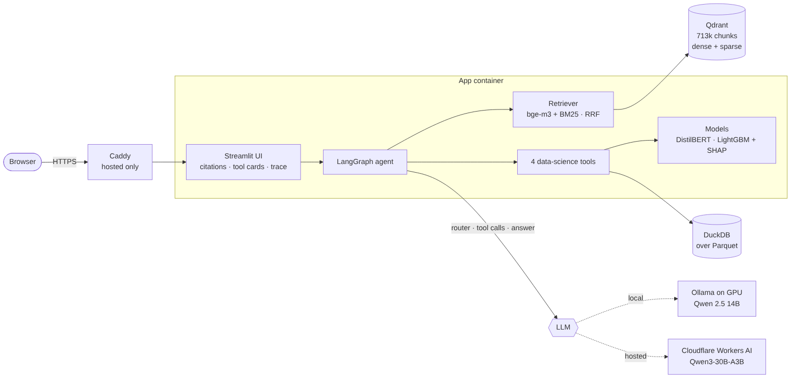
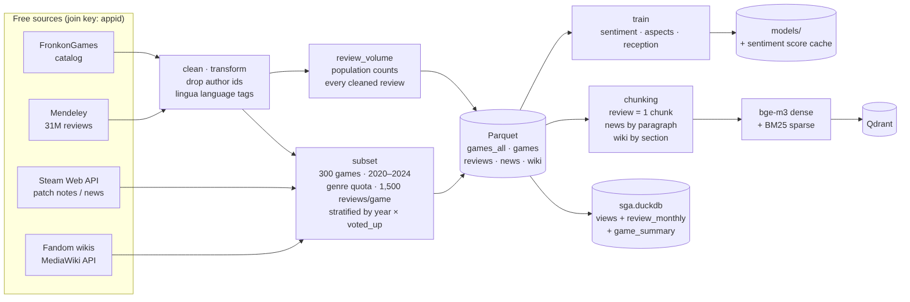
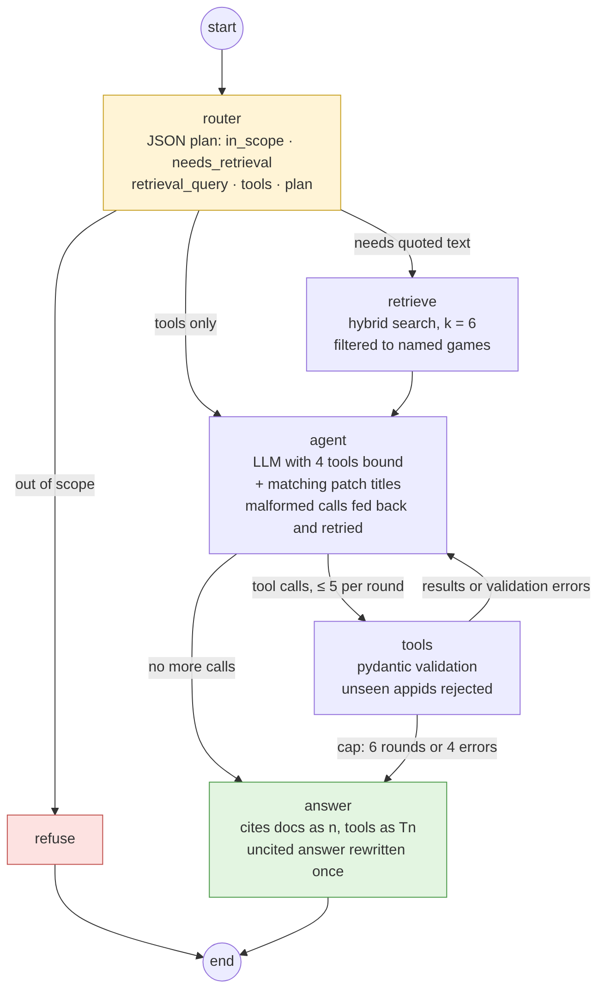
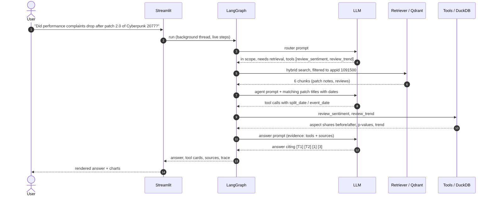
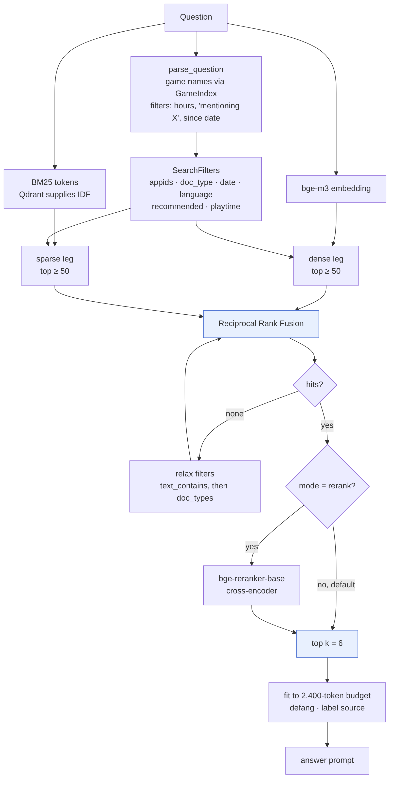
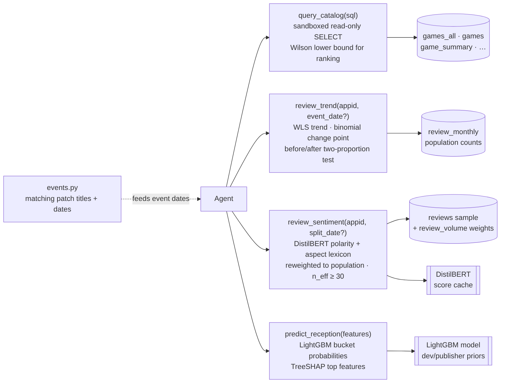
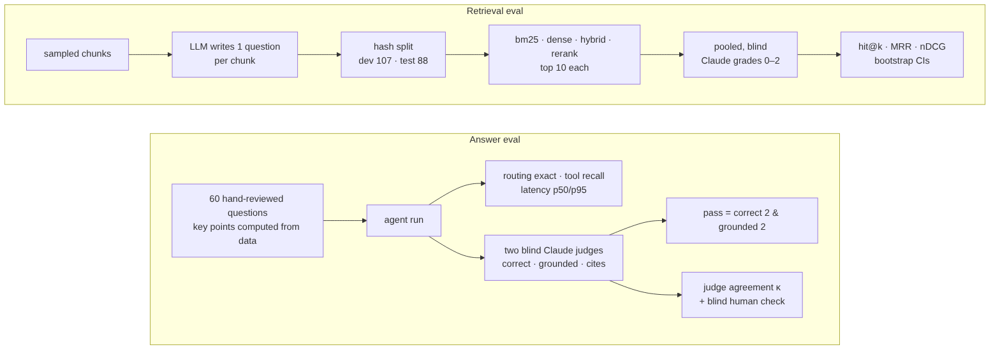

# Architecture

How Steam Game Analyst turns a question into a cited answer. The agent uses two kinds of
evidence. **Retrieval (RAG)** answers "what do players, patch notes and wikis say". The
**data-science tools** answer "what do the numbers say": SQL, trend tests, reweighted
sentiment and a predictive model. The answer must cite both, documents as `[n]` and tool
results as `[Tn]`.

Diagram sources live in [`docs/diagrams/`](diagrams/) (Mermaid). To re-render them:

```bash
cd docs/diagrams
for f in *.mmd; do npx -y @mermaid-js/mermaid-cli@11.4.2 -i "$f" -o "../img/arch-${f%.mmd}.png" -s 2 -b white; done
```

## 1. System overview



| Component | Code | Role |
| --- | --- | --- |
| Streamlit UI | `ui/` | Runs the agent on a background thread and streams its steps. Renders citation chips, tool cards (trend charts, before/after aspect bars), sources and the trace. Checks LLM and Qdrant health and enforces the visitor quota (hosted). |
| LangGraph agent | `agent/graph.py` | State machine: router → retrieve → agent ⇄ tools → answer ([section 3](#3-agent-graph)). |
| LLM | `agent/llm.py` | `ollama` provider locally (Qwen 2.5 14B on the GPU) or `openai` provider for any OpenAI-compatible endpoint (hosted: Qwen3-30B-A3B on Cloudflare Workers AI). The router uses the same model at temperature 0 (JSON mode on Ollama). |
| Retriever | `retrieval/` | Hybrid dense + BM25 search over Qdrant ([section 4](#4-retrieval-rag)). |
| Tools | `tools/` | Four validated, sandboxed analytics functions ([section 5](#5-data-science-tools)). |
| DuckDB | `data/build.py` | Views over Parquet, plus the `review_monthly` and `game_summary` tables. |
| Qdrant | `retrieval/store.py` | One collection, `sga_chunks`: 713k chunks, each with a dense and a sparse vector and filterable payload fields. |

**Deployments.** Both run the same code through Docker Compose.

| | Local | Hosted (W6) |
| --- | --- | --- |
| Machine | Linux box, RTX 3080 10 GB | Oracle Always Free A1, 2 OCPU / 12 GB, arm64 |
| LLM | Ollama, Qwen 2.5 14B q4 | Workers AI `@cf/qwen/qwen3-30b-a3b-fp8` |
| Query embeddings | bge-m3 on the CPU (the GPU is held by the LLM) | bge-m3 on the CPU |
| TLS | none | Caddy + Let's Encrypt on `<ip>.sslip.io` |

## 2. Data pipeline



`make data` → `make index` → `sga train …`.

1. **Download** four free sources, all joined on Steam `appid` (`data/download.py`, `data/wiki.py`).
2. **Clean** (`data/clean.py`, `data/transform.py`): canonical columns, author and Steam ids
   dropped, every review language-tagged with `lingua` (Mendeley has no language column).
3. **Population counts**: `review_volume.parquet` counts every cleaned review per game and
   month. It is the population that the trend tool reads and the sentiment tool reweights to.
4. **Subset** (`data/subset.py`, `configs/pipeline.yaml`): 300 games released 2020–2024,
   at most 40 per primary genre, plus a must-include list of live-service titles with rich
   patch histories. Each game gets 1,500 reviews, stratified by year × voted_up.
5. **Store**: Parquet files + `sga.duckdb` (views, `review_monthly`, `game_summary`).
6. **Index** (`retrieval/chunking.py`, `index.py`): one chunk per review, news split by
   paragraph, wiki split by section. Long text is cut at sentence boundaries with token
   overlap. Each chunk is embedded with bge-m3 (GPU) and gets a BM25 sparse vector.
7. **Train** (`ml/`): the sentiment classifier, the aspect lexicon or model, and the
   reception model. A score cache holds DistilBERT outputs for all 342k review and aspect
   sentences, so tool calls don't run BERT live.

## 3. Agent graph



| Node | What it does |
| --- | --- |
| `router` | One LLM call returns a `RouterDecision`: `in_scope`, `needs_retrieval`, `retrieval_query`, `tools`, `plan`. Out of scope goes to `refuse`. A question that doesn't need quotes skips retrieval. |
| `retrieve` | Hybrid search, k = 6, restricted to the games named in the question that have reviews. If the vector store is down, a note is recorded and the agent continues with tools only. |
| `agent` | LLM with the four tools bound. Its prompt also lists patch-note titles that match the question, with dates (`tools/events.py`), because patch-impact answers depend on the right event date. |
| `tools` | Validates arguments with pydantic and rejects appids the agent has never seen. Errors go back to the model as messages so it can correct itself. |
| `answer` | Writes the final answer from tool outputs (~14k chars) and sources (~2.4k tokens). Every claim must be cited. An uncited answer is rewritten once. |

Limits: 6 agent rounds, 4 invalid calls, 5 calls per round. Every run is appended to
`data/traces/agent.jsonl`. There is no chat memory: each question is answered on its own.

### Example run



## 4. Retrieval (RAG)



**Query understanding** (`retrieval/query.py`, `filters.py`). `GameIndex` finds game names
in the question; it also matches the main title before a colon ("New World" → *New World:
Aeternum*). Simple phrases become `SearchFilters`:

| Phrase | Filter |
| --- | --- |
| "50+ hours" | `min_playtime_min` |
| "mentioning DLSS" | `text_contains` |
| "since 2023" | `date_from` |
| (named games) | `appids` |

**Two legs, one ranking** (`retrieval/store.py`):

- **Dense**: bge-m3 embeddings. Catches paraphrase ("stutters" ≈ "frame drops").
- **Sparse**: BM25 sparse vectors computed in-process; Qdrant supplies the IDF. Catches
  exact names, versions and jargon ("Patch 2.0", "DLSS").
- **RRF** fuses the two rankings. Each leg passes at least 50 candidates.
- If filters leave no hits, they are relaxed in order: `text_contains`, then `doc_types`.
- **Optional rerank**: `bge-reranker-base` cross-encoder (`retrieval/rerank.py`).

**Prompt assembly** (`retrieval/rag.py`): each chunk is labelled with game, type and date,
trimmed to its share of the budget, and defanged so document text can't close its source
fence or forge a citation number.

**Why hybrid and not rerank by default.** On the frozen test split (82 questions, pooled
Claude grades):

| Mode | hit@10 | MRR@10 | nDCG@10 |
| --- | --- | --- | --- |
| BM25 | 0.780 | 0.609 | 0.451 |
| Dense | 0.866 | 0.710 | 0.570 |
| **Hybrid (default)** | 0.890 | 0.727 | 0.572 |
| Hybrid + rerank | 0.927 | 0.824 | 0.679 |

Reranking ranks chunks better, but it did not improve the end-to-end answers on dev, and it
was slower. So hybrid is the default.

## 5. Data-science tools



| Tool | Data | Method | Guard rails |
| --- | --- | --- | --- |
| `query_catalog(sql)` (`tools/catalog.py`) | full catalog (`games_all`) and the subset views | One read-only SELECT. Adds `n_votes` and `positive_ratio_lower95`, a **Wilson lower bound**, so tiny-sample 100% games don't top rankings. | Parser allow-list (no table functions or qualified names), sandboxed connection (no files outside `data/processed/`, locked config, 1 GB), 20 s timeout, 200 rows, 500-char cells, "did you mean" tags on empty results |
| `review_trend(appid, …, event_date?)` (`tools/trend.py`) | `review_monthly`: population counts, not the sample | Monthly or quarterly positive share; **weighted least-squares** slope with a t-test; either a **binomial change-point** search or a **two-proportion z-test** before and after `event_date` | windows relative to the game's last complete month (data ends late 2024) |
| `review_sentiment(appid, from, to, split_date?)` (`tools/sentiment.py`) | English review sample | **DistilBERT** polarity (cached scores) + keyword **aspect lexicon** (performance, bugs, gameplay, story, price, controls). Shares are **reweighted to the population** with per-(game, year, voted_up) stratum weights. A before/after test per aspect. | window widened when a side has fewer than 30 *effective* reviews; small-sample warning in the UI |
| `predict_reception(features)` (`ml/reception.py`) | catalog history | **LightGBM** gives review-bucket probabilities for a hypothetical launch; **TreeSHAP** gives the top features. Main features: the developer's and publisher's earlier ratings, release year, price. | inputs validated by `GameSpec`; caveats travel with the output |

The statistics (`tools/stats.py`) are implemented directly with no SciPy dependency:
normal and chi² tails, the incomplete beta for t-tests, Kish effective n and binomial
log-likelihoods.

**Models** (held out by game):

| Model | Metric | Score | Baseline |
| --- | --- | --- | --- |
| Sentiment, DistilBERT | F1 (positive) | 0.913 | TF-IDF + LR 0.884 |
| Aspects, lexicon (kept) | macro-F1 | 0.730 | DistilBERT aspects 0.736 (tie) |
| Reception, LightGBM | accuracy / ECE | 0.661 / 0.007 | majority 0.645 / 0.145 |

## 6. Evaluation



- **Retrieval** (`eval/synth.py`, `eval/retrieval.py`, `eval/judged.py`, `eval/ablation.py`):
  one LLM-written question per sampled chunk, a frozen dev/test split by hashing the
  question id, pooled blind grading of every mode's top 10, and paired-bootstrap differences
  between modes.
- **Answers** (`eval/answers.py`, `eval/answer_judge.py`): 60 hand-reviewed questions whose
  key points were computed from the data. Two blind Claude judges grade each answer as
  correct, grounded and cited; a blind human check calibrates them. Test pass rate is
  0.35–0.40 locally, comparable hosted. Most failures come from tool choices (wrong catalog
  query, wrong patch date), rarely from retrieval.
- Configuration choices (retrieval mode, prompts, model size) were made on dev. Test was run
  once.

## 7. Design principles

- **Every number has a source.** Numbers come from a tool output or a document, and the
  answer prompt enforces citations.
- **Population, not the sample.** Volume and trend questions read population counts; text
  questions use the sample reweighted to the population.
- **Fail loudly, degrade gracefully.** Invalid tool calls are fed back to the model. A dead
  vector store falls back to tools only. The UI names whichever service is down.
- **Untrusted inputs are sandboxed.** That covers LLM-written SQL, retrieved text (defanged)
  and appids (only ones already seen).
- **Tune on dev, report test once.** This applies to retrieval, answers and model choices.
